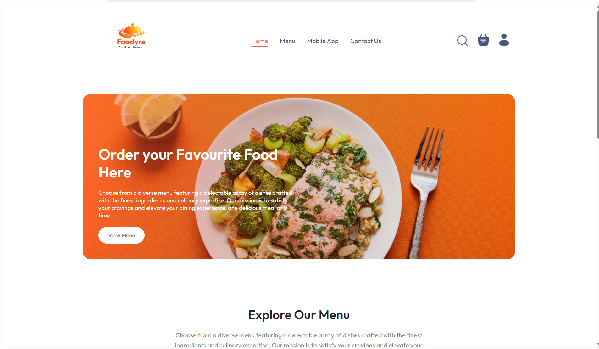
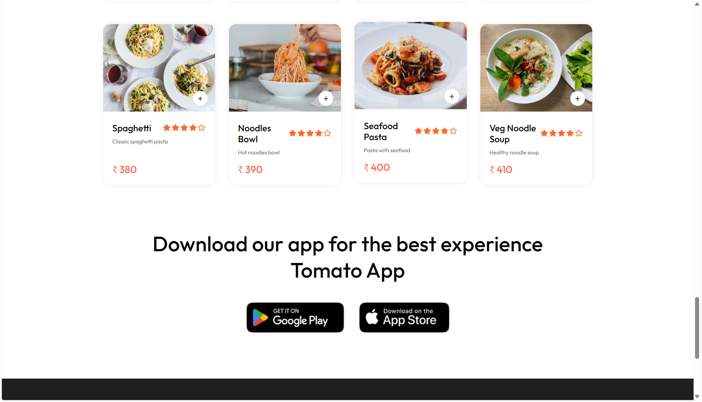
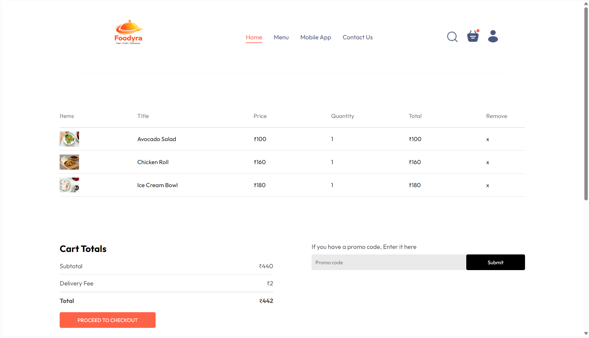
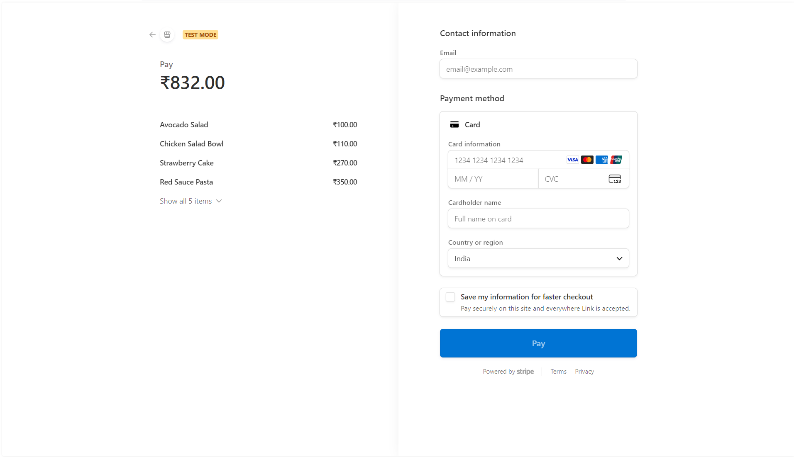
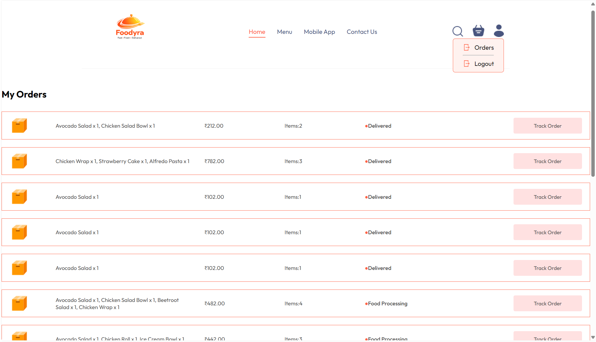
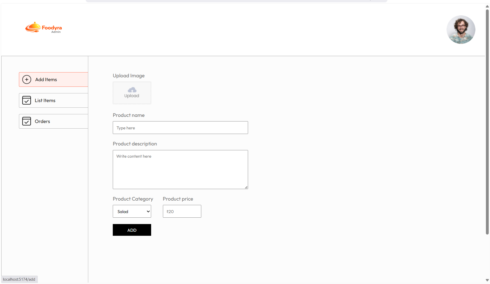
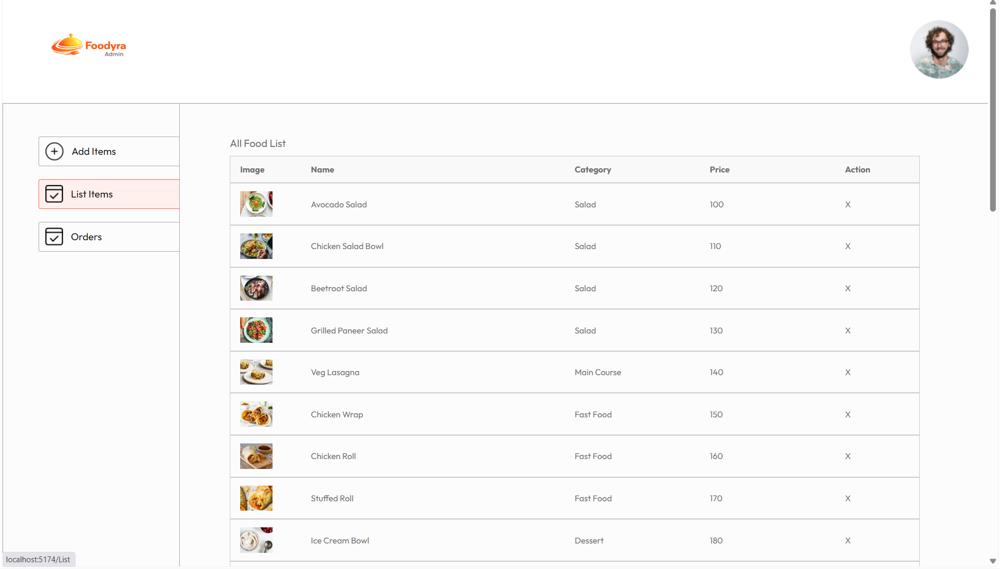
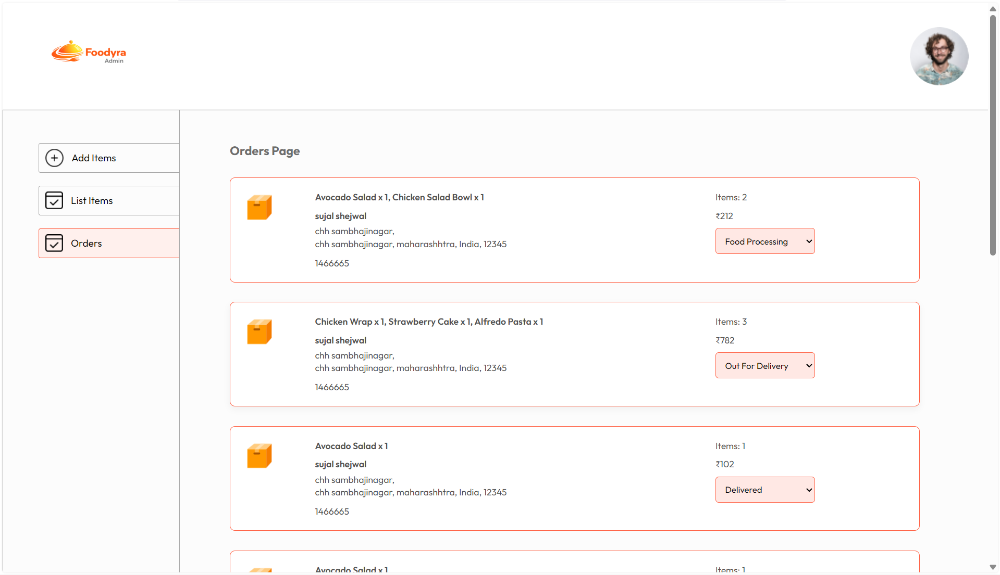

# Foodyra Food Delivery Platform


<p align="center">
  <a href="https://food-delivery-app-lemon-phi.vercel.app">
    
  </a>
  <a href="https://food-delivery-app-gd5y.vercel.app">
    
  </a>
</p>

---

## 📌 Overview

A **full-stack food delivery platform** built with React, Express, and MongoDB. Customers discover restaurants created in the admin panel, browse each restaurant's assigned menu, add items from one restaurant to a cart, and check out through Stripe.

This project demonstrates **real-world full-stack development**, including:

* Deployment (Vercel + Render)
* API integration
* Admin dashboard management
* Handling production issues (CORS, routing)

---

## 🌐 Live Demo

### 🚀 User Frontend

👉 https://food-delivery-app-lemon-phi.vercel.app

### 🛠 Admin Panel

👉 https://food-delivery-app-gd5y.vercel.app

### ⚙ Backend API

👉 https://food-delivery-backend-rbic.onrender.com

---

## 🏗 Deployment Architecture

* 🌐 Frontend → Vercel
* 🛠 Admin Panel → Vercel
* ⚙ Backend → Render
* 🗄 Database → MongoDB Atlas

---

## 🚀 Features

* 🔐 User Authentication (Login / Signup)
* 🛒 Add to Cart & Order Management
* 💳 Secure Payment Integration (Stripe)
* 📦 Order Tracking System
* 🧑‍💼 Admin Dashboard for managing food & orders
* 🔄 Real-time data sync (Frontend ↔ Admin)
* 🔔 Notifications System

---

## 🛠️ Tech Stack

### 🔹 Frontend

* React.js (Vite)
* CSS
* Axios

### 🔹 Backend

* Node.js
* Express.js

### 🔹 Database

* MongoDB Atlas

### 🔹 Tools & Services

* Stripe API
* JWT Authentication

---

## 📂 Project Structure

```
Food-Delivery/
│
├── frontend/   # User Website (Vercel)
├── backend/    # Server & APIs (Render)
├── admin/      # Admin Dashboard (Vercel)
```

---

## Setup Instructions

### Clone the repository

```
git clone https://github.com/Sujal-Shejwal/food-delivery-app.git
```

### Install dependencies

```
cd frontend && npm install
cd ../backend && npm install
cd ../admin && npm install
```

### Environment variables

Copy `backend/.env.example` to `backend/.env` and set real values. Do not commit `.env`. Use a long random `JWT_SECRET`, set `ADMIN_EMAIL` and a strong `ADMIN_PASSWORD`, and set the Stripe secret only on the backend. The local backend defaults to development and uses `MONGO_URI_LOCAL` (or `mongodb://127.0.0.1:27017/food_delivery`) so Atlas TLS/network issues do not block local sign-in and sign-up. For deployment, explicitly set `NODE_ENV=production`, configure `MONGO_URI` for Atlas, and allow the deployed backend in Atlas Network Access.

The admin email and password are not preset and have no default login. Add your own values to `backend/.env`, for example:

```env
ADMIN_EMAIL=you@example.com
ADMIN_PASSWORD=<your-own-strong-password>
```

Restart the backend after saving. Use corresponding environment settings on the deployed backend (such as Render); never place the admin password in frontend `.env` files.

Set `VITE_API_URL` in `frontend/.env` and `admin/.env` only when using a non-default API URL. For local development both use `http://localhost:4000`; production should point both to the same deployed API. Configure `CORS_ORIGINS` for any custom deployed frontend and admin domains.

The admin portal requires the backend `ADMIN_EMAIL` and `ADMIN_PASSWORD` configuration. If these are missing, the sign-in API returns a clear setup error instead of accepting a default password. Admin API mutations use a signed, expiring admin JWT; customer registration/login remains separate.

Legacy food records are preserved. In the admin Food List, assign each legacy item to a restaurant before it appears in customer restaurant menus. Restaurant deactivation preserves associated foods and order history.

## Run locally (PowerShell)

Start MongoDB first. In three separate terminals, run:

```powershell
Set-Location 'C:\Users\sayan\Downloads\food-delivery-app-main\food-delivery-app-main\backend'
$env:NODE_ENV = 'development'
npm run server
```

```powershell
Set-Location 'C:\Users\sayan\Downloads\food-delivery-app-main\food-delivery-app-main\frontend'
npm run dev
```

```powershell
Set-Location 'C:\Users\sayan\Downloads\food-delivery-app-main\food-delivery-app-main\admin'
npm run dev
```

Local URLs: customer website `http://localhost:5173`, admin panel `http://localhost:4173`, backend `http://localhost:4000`. If port 5173 is occupied, Vite may select the next available port; use the URL printed in that terminal.

Create a restaurant in Admin → Restaurants before adding foods. Choose its restaurant when creating each menu item. Restaurant discovery intentionally uses database records only; no fictional restaurant data or ratings are inserted.

---

## 📸 Screenshots

### 🏠 User Flow

#### Homepage



#### Menu



#### Cart



#### Checkout



#### Orders



---

### 🧑‍💼 Admin Panel

#### Add Food Item



#### Food List



#### Orders Management



---

## 💡 Key Highlights

* Full-stack MERN application
* Separate Admin & User systems
* Production deployment (Vercel + Render)
* Solved real-world issues (CORS, routing, API handling)
* Scalable architecture

---

## 👨‍💻 Author

**Sujal Shejwal**

* GitHub: https://github.com/Sujal-Shejwal

---

## ⭐ Support

If you like this project, give it a ⭐ on GitHub!
